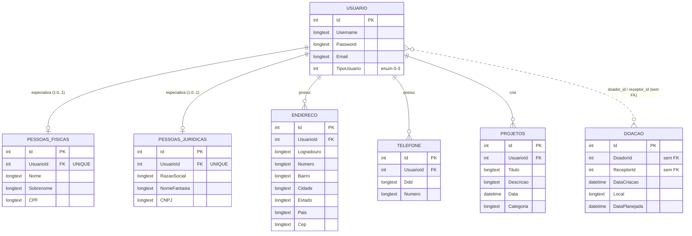

# Modelo de Dados Atual — DER e Dicionário de Dados

> **DOC-10 — Issue #189** · Equipe de Documentação · Semestre 2026/2

## 1. Escopo e fonte

Este documento descreve o modelo de dados **como está implementado hoje**, e não o modelo planejado.

| Item | Valor |
|---|---|
| Fonte | Branch `dev-backend`, pasta `api/` (classes em `Models/`, `ApplicationDbContext` e `Migrations/ApplicationDbContextModelSnapshot.cs`) |
| Último commit analisado | `bc7f7b6` (merge do PR #51, CRUD de Projeto) |
| SGBD | MySQL (provider Pomelo, EF Core 9.0.10) |
| Tabelas | 7: `Usuario`, `PessoasFisicas`, `PessoasJuridicas`, `Endereco`, `Telefone`, `Projetos`, `Doacao` |

> O modelo **planejado** (com `Agendamento`, valor e forma de pagamento da doação, data de nascimento, razão social em PJ, relação de responsável etc.) está em [`entidades-envolvidas.md`](./entidades-envolvidas.md) e no diagrama [`er.jpeg`](./er.jpeg). A seção 5 compara os dois.

---

## 2. Diagrama Entidade-Relacionamento (DER)

### 2.1 Relacionamentos

| Origem | Destino | Cardinalidade | Chave estrangeira | `ON DELETE` | Observação |
|---|---|---|---|---|---|
| `Usuario` | `PessoasFisicas` | 1 : 0..1 | `PessoasFisicas.UsuarioId` (índice único) | CASCADE | Um usuário tem no máximo um perfil de pessoa física |
| `Usuario` | `PessoasJuridicas` | 1 : 0..1 | `PessoasJuridicas.UsuarioId` (índice único) | CASCADE | Um usuário tem no máximo um perfil de pessoa jurídica |
| `Usuario` | `Endereco` | 1 : N | `Endereco.UsuarioId` | CASCADE | |
| `Usuario` | `Telefone` | 1 : N | `Telefone.UsuarioId` | CASCADE | |
| `Usuario` | `Projetos` | 1 : N | `Projetos.UsuarioId` | CASCADE | Usuário que criou o projeto |
| `Usuario` | `Doacao` | 1 : N (doador) e 1 : N (receptor) | **nenhuma** | — | `DoadorId` e `ReceptorId` são inteiros comuns, sem restrição no banco |

Não há relacionamento entre `Doacao` e `Projetos` no modelo atual.

### 2.2 Especialização de usuário

O tipo do usuário é definido pelo enum `TipoUsuario` (coluna `Usuario.TipoUsuario`, `int`):

| Valor | Nome |
|---|---|
| 0 | Indefinido |
| 1 | Administrador |
| 2 | PessoaFisica |
| 3 | PessoaJuridica |

O banco **não impede** que um mesmo usuário tenha registros em `PessoasFisicas` e `PessoasJuridicas` ao mesmo tempo, nem que o `TipoUsuario` seja incoerente com o perfil existente. Essa coerência depende da aplicação.

---

## 3. Dicionário de Dados

Convenções válidas para todas as tabelas:

- Todas as chaves primárias (`Id`) são `int`, `AUTO_INCREMENT`.
- Todo campo de texto é `longtext` e `NOT NULL`. Não há limite de tamanho nem coluna opcional.
- Datas são `datetime(6)`. Os valores padrão `DateTime.Now` existem **no código C#**, não como `DEFAULT` no banco.
- Os índices listados são os únicos além das chaves primárias. Não há índice único em e-mail, username, CPF ou CNPJ.

### 3.1 `Usuario`

Conta de acesso à plataforma.

| Coluna | Tipo | Nulo | Chave / Índice | Descrição |
|---|---|---|---|---|
| `Id` | int | Não | PK | Identificador do usuário |
| `Username` | longtext | Não | — | Nome de usuário para login |
| `Password` | longtext | Não | — | Senha do usuário (ver alerta na seção 4) |
| `Email` | longtext | Não | — | E-mail do usuário, também aceito no login |
| `TipoUsuario` | int | Não | — | Enum `TipoUsuario`: 0 Indefinido, 1 Administrador, 2 PessoaFisica, 3 PessoaJuridica |

### 3.2 `PessoasFisicas`

Dados específicos de usuário pessoa física.

| Coluna | Tipo | Nulo | Chave / Índice | Descrição |
|---|---|---|---|---|
| `Id` | int | Não | PK | Identificador |
| `UsuarioId` | int | Não | FK → `Usuario.Id` (CASCADE), índice único | Usuário dono do perfil |
| `Nome` | longtext | Não | — | Primeiro nome |
| `Sobrenome` | longtext | Não | — | Sobrenome |
| `CPF` | longtext | Não | — | CPF da pessoa |

### 3.3 `PessoasJuridicas`

Dados específicos de usuário pessoa jurídica.

| Coluna | Tipo | Nulo | Chave / Índice | Descrição |
|---|---|---|---|---|
| `Id` | int | Não | PK | Identificador |
| `UsuarioId` | int | Não | FK → `Usuario.Id` (CASCADE), índice único | Usuário dono do perfil |
| `RazaoSocial` | longtext | Não | — | Razão social |
| `NomeFantasia` | longtext | Não | — | Nome fantasia |
| `CNPJ` | longtext | Não | — | CNPJ da empresa |

### 3.4 `Endereco`

Endereços de um usuário (um usuário pode ter vários).

| Coluna | Tipo | Nulo | Chave / Índice | Descrição |
|---|---|---|---|---|
| `Id` | int | Não | PK | Identificador |
| `UsuarioId` | int | Não | FK → `Usuario.Id` (CASCADE), índice | Usuário dono do endereço |
| `Logradouro` | longtext | Não | — | Rua, avenida etc. |
| `Numero` | longtext | Não | — | Número (texto, aceita "S/N" ou complemento) |
| `Bairro` | longtext | Não | — | Bairro |
| `Cidade` | longtext | Não | — | Cidade |
| `Estado` | longtext | Não | — | Estado/UF |
| `Pais` | longtext | Não | — | País |
| `Cep` | longtext | Não | — | CEP |

### 3.5 `Telefone`

Telefones de um usuário (um usuário pode ter vários).

| Coluna | Tipo | Nulo | Chave / Índice | Descrição |
|---|---|---|---|---|
| `Id` | int | Não | PK | Identificador |
| `UsuarioId` | int | Não | FK → `Usuario.Id` (CASCADE), índice | Usuário dono do telefone |
| `Ddd` | longtext | Não | — | Código de área |
| `Numero` | longtext | Não | — | Número do telefone |

### 3.6 `Projetos`

Projetos criados por usuários.

| Coluna | Tipo | Nulo | Chave / Índice | Descrição |
|---|---|---|---|---|
| `Id` | int | Não | PK | Identificador |
| `UsuarioId` | int | Não | FK → `Usuario.Id` (CASCADE), índice | Usuário que criou o projeto |
| `Titulo` | longtext | Não | — | Título do projeto |
| `Descricao` | longtext | Não | — | Descrição do projeto |
| `Data` | datetime(6) | Não | — | Data do projeto (padrão no código: data/hora atual) |
| `Categoria` | longtext | Não | — | Categoria do projeto (texto livre) |

### 3.7 `Doacao`

Registro de uma doação entre dois usuários.

| Coluna | Tipo | Nulo | Chave / Índice | Descrição |
|---|---|---|---|---|
| `Id` | int | Não | PK | Identificador |
| `DoadorId` | int | Não | **sem FK** | Id do usuário doador |
| `ReceptorId` | int | Não | **sem FK** | Id do usuário receptor |
| `DataCriacao` | datetime(6) | Não | — | Data de criação do registro (padrão no código: data/hora atual) |
| `Local` | longtext | Não | — | Local da doação |
| `DataPlanejada` | datetime(6) | Não | — | Data planejada para a doação |

---

## 4. Pontos de atenção do modelo atual

Observações verificadas no código da `dev-backend`. Não são alterações: servem de insumo para as equipes de banco, back-end e QA.

| # | Ponto | Impacto | Onde |
|---|---|---|---|
| 1 | **Senha em texto puro.** `Usuario.Password` guarda a senha como recebida, e o login compara os textos diretamente. O `AuthController` também imprime a senha no console. | Segurança. Contraria o RNF-001 (armazenar apenas hash) | `Models/Usuario.cs`, `Controllers/AuthController.cs` |
| 2 | **`Doacao` sem chaves estrangeiras.** `DoadorId` e `ReceptorId` aceitam ids inexistentes. | Contraria o RNF-007 (integridade referencial) | `Models/Doacao.cs`, snapshot |
| 3 | **`Doacao` não se liga a `Projetos`.** Não dá para saber a qual projeto uma doação pertence. | Funcional: o fluxo planejado liga doação a projeto | `Models/Doacao.cs` |
| 4 | **Sem unicidade** em `Email`, `Username`, `CPF` e `CNPJ`. | Permite cadastros duplicados | snapshot |
| 5 | **Todos os textos são `longtext`** (sem tamanho máximo) e não há validação de formato no banco. | Desempenho e qualidade dos dados; CPF e CNPJ não podem ser indexados com eficiência | snapshot |
| 6 | **Especialização sem garantia no banco.** Um usuário pode ter PF e PJ ao mesmo tempo, e `TipoUsuario` pode divergir do perfil. | Integridade | seção 2.2 |
| 7 | **Exclusão em cascata** de `Usuario` apaga perfis, endereços, telefones e projetos. As doações **não** são apagadas, ficando órfãs. | Perda de dados e registros órfãos | snapshot |
| 8 | **Sem campos de auditoria** (criação/alteração por usuário) e sem status em usuário, projeto ou doação. | Contraria o RNF-009 | todas as tabelas |

---

## 5. Comparação com o modelo planejado

Referência: [`entidades-envolvidas.md`](./entidades-envolvidas.md) e [`er.jpeg`](./er.jpeg).

| Elemento planejado | Situação no código atual |
|---|---|
| `USUARIO` com data de cadastro e status | Parcial. Existem `Username`, `Password`, `Email` e `TipoUsuario`; faltam data de cadastro e status |
| `TELEFONE` 1:N com usuário | Implementado |
| `ENDERECO` 1:N com usuário | Implementado. Existe o campo `Pais`, além do que foi planejado |
| `PESSOA FISICA` com CPF e data de nascimento | Parcial. Tem `CPF`, `Nome` e `Sobrenome`; **falta data de nascimento** |
| `PESSOA JURIDICA` com CNPJ e razão social | Implementado, com `NomeFantasia` extra |
| Relação `RESPONSAVEL` (PF → PJ) | **Não implementado** |
| `DOACAO` com valor, forma de pagamento e observações | **Diferente.** O código tem doador, receptor, local e data planejada; não há valor, forma de pagamento nem observações |
| `DOACAO` ligada a `PROJETO` | **Não implementado** |
| `PROJETO` com nome, descrição, objetivo, período e status | Parcial. Tem `Titulo`, `Descricao`, `Data` e `Categoria`; faltam objetivo, período e status |
| `AGENDAMENTO` | **Não implementado** (a `Doacao` atual tem `DataPlanejada`, que cobre parte da ideia) |

Também diferem dos requisitos ([`requisitos.md`](./requisitos.md)) os conceitos de **Entidade assistencial** e **Campanha**, que não existem como tabelas na `dev-backend`.

> A branch `cadastro-entidades` possui um schema Prisma separado (`Usuario`, `PessoaFisica`, `PessoaJuridica`, `Entidade`, `EnderecoEntidade`, `Endereco`, `Telefone`). Ele não faz parte do modelo da API .NET descrito aqui e não foi detalhado neste documento.

---

## 6. Como manter este documento

- A fonte da verdade é `api/Migrations/ApplicationDbContextModelSnapshot.cs`. Revise este documento sempre que uma migration nova for aprovada.
- Para ver a estrutura real no banco após `dotnet ef database update`, use `SHOW CREATE TABLE <tabela>;` no MySQL.
- Se a stack do back-end for redefinida (os documentos [`arquitetura.md`](./arquitetura.md) e [`stack.md`](./stack.md) citam Spring Boot e PostgreSQL, mas o código da `dev-backend` é .NET com MySQL), este documento deve ser refeito a partir do novo schema.
