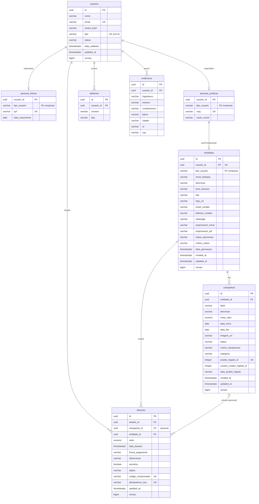

# Modelo de Dados Atual — DER e Dicionário de Dados

> **DOC-10 — Issue #189** · Equipe de Documentação · Semestre 2026/2

## 1. Escopo e fonte

Este documento descreve o modelo de dados **como o banco real é criado hoje**, a partir das migrações Flyway do back-end oficial. Ele complementa o diagrama oficial [`DER.png`](./DER.png) (desenho do modelo) com o que a imagem não mostra: tipos, tamanhos, obrigatoriedade, constraints e índices. As diferenças entre as duas fontes estão na seção 5.

| Item | Valor |
|---|---|
| Fonte | Repositório [`doasync-backend`](https://github.com/PrjDoaSync/doasync-backend) (privado), branch `develop`, pasta `backend/src/main/resources/db/migration` |
| Commit analisado | `afc850e` |
| Migrações | V1 a V6 (a V5 é uma migração Java: `db.migration.V5__campanha_status_agendada`) |
| SGBD | PostgreSQL 16 em homologação e produção; H2 em modo PostgreSQL em desenvolvimento e testes |
| Tabelas de negócio | 8: `usuarios`, `pessoas_fisicas`, `pessoas_juridicas`, `telefones`, `enderecos`, `entidades`, `campanhas`, `doacoes` |
| Tabela técnica | `flyway_schema_history` (controle das migrações, criada pelo Flyway) |

> **Mudança em relação à versão anterior deste documento.** A versão anterior descrevia a branch `dev-backend` (.NET + MySQL), do semestre passado, que não faz parte do projeto atual. Este documento passa a usar apenas o back-end Spring Boot, conforme a stack definida em [`stack.md`](./stack.md).

### 1.1 Como foi verificado

- As migrações V1 a V6 foram aplicadas do zero em um banco H2 (modo PostgreSQL) e o schema resultante foi lido do `information_schema`. O Flyway registrou as 6 migrações com sucesso, e colunas, tipos, tamanhos e obrigatoriedade deste documento foram conferidos contra esse resultado.
- A suíte `ModeloDadosJpaTest` do back-end (25 testes, com `ddl-auto=validate`) passou, o que confirma que as entidades JPA estão consistentes com o schema das migrações.
- **Não verificado:** a aplicação das migrações em um PostgreSQL 16 real. O Docker não estava disponível. Os tipos abaixo seguem o SQL das migrações, que é compatível com PostgreSQL.
- Os **índices** (seção 3.10) foram lidos dos arquivos `.sql`, e não do banco.

---

## 2. Diagrama Entidade-Relacionamento (DER)

O diagrama abaixo é gerado a partir das migrações. O desenho oficial, com cores e legendas de regras de negócio, é o [`DER.png`](./DER.png).

### 2.1 Relacionamentos

Todas as chaves estrangeiras usam `ON DELETE RESTRICT` (RN51: não há exclusão física, o histórico é preservado).

| Origem | Destino | Cardinalidade | Chave estrangeira | Observação |
|---|---|---|---|---|
| `usuarios` | `pessoas_fisicas` | 1 : 0..1 | `(usuario_id, tipo_usuario)` → `usuarios(id, tipo)` | A PK da subtabela é o próprio `usuario_id` |
| `usuarios` | `pessoas_juridicas` | 1 : 0..1 | `(usuario_id, tipo_usuario)` → `usuarios(id, tipo)` | Aceita `tipo_usuario` PESSOA_JURIDICA ou ENTIDADE |
| `pessoas_juridicas` | `entidades` | 1 : 0..1 | `(usuario_id, tipo_usuario)` → `pessoas_juridicas(usuario_id, tipo_usuario)` | Só PJ do tipo ENTIDADE tem perfil institucional |
| `usuarios` | `telefones` | 1 : N | `telefones.usuario_id` | |
| `usuarios` | `enderecos` | 1 : N | `enderecos.usuario_id` | |
| `entidades` | `campanhas` | 1 : N | `campanhas.entidade_id` | |
| `usuarios` | `doacoes` | 1 : N | `doacoes.doador_id` → `usuarios(id)` | Qualquer tipo de usuário é aceito pelo banco como doador |
| `entidades` | `doacoes` | 1 : N | `doacoes.entidade_id` | Destino contabilizado, sempre preenchido |
| `campanhas` | `doacoes` | 1 : 0..N | `(campanha_id, entidade_id)` → `campanhas(id, entidade_id)` | Campanha opcional (doação direta à entidade). Quando existe, a entidade da doação tem de ser a dona da campanha |

### 2.2 Especialização do usuário (RN41)

A especialização é **total e disjunta**. O banco impede que o mesmo usuário seja PF e PJ ao mesmo tempo e impede trocar o `tipo` de um usuário que já tem especialização, graças à FK composta `(usuario_id, tipo_usuario)`.

| `usuarios.tipo` | Subtabela | Observação |
|---|---|---|
| `PESSOA_FISICA` | `pessoas_fisicas` | CPF e data de nascimento |
| `PESSOA_JURIDICA` | `pessoas_juridicas` | CNPJ e razão social |
| `ENTIDADE` | `pessoas_juridicas` **e** `entidades` | A entidade também é PJ (RN41) |
| `ADMIN` | nenhuma | RN50 |

O banco **não obriga** que todo usuário PF, PJ ou ENTIDADE tenha a sua linha de especialização. Essa totalidade é garantida pelo serviço de cadastro, na mesma transação.

---

## 3. Dicionário de Dados

Convenções válidas para todas as tabelas:

- **Obrig.:** "Sim" = `NOT NULL`; "Não" = aceita nulo.
- **Chaves primárias `id` (UUID)** não têm `DEFAULT` no banco: o valor é informado pela aplicação.
- **Colunas de data/hora** (`created_at`, `updated_at`, `data_cadastro`, `data_doacao`) são `TIMESTAMP WITH TIME ZONE`, `NOT NULL` e sem `DEFAULT`: a aplicação as preenche.
- **`versao`** (`BIGINT`, padrão `0`) é o contador de controle de concorrência otimista, usado pelo JPA.
- **Textos obrigatórios** têm `CHECK (LENGTH(TRIM(coluna)) > 0)`, ou seja, não aceitam valor vazio ou só com espaços.
- **Valores com máscara:** CPF (`000.000.000-00`, 14 caracteres), CNPJ (`00.000.000/0000-00`, 18) e CEP (`00000-000`, 9) são gravados **com máscara**.

### 3.1 `usuarios`

Conta de acesso à plataforma (RN42, RN49).

| Coluna | Tipo | Obrig. | Chave / Constraint | Descrição |
|---|---|---|---|---|
| `id` | UUID | Sim | PK | Identificador do usuário |
| `nome` | VARCHAR(200) | Sim | CHECK não vazio | Nome do usuário |
| `email` | VARCHAR(254) | Sim | UNIQUE `uq_usuario_email`; CHECK `email = LOWER(TRIM(email))` | E-mail de login, **gravado normalizado** (minúsculas, sem espaços) |
| `senha_hash` | VARCHAR(255) | Sim | CHECK não vazio | Hash da senha. A senha nunca é guardada em texto puro |
| `tipo` | VARCHAR(20) | Sim | CHECK em `PESSOA_FISICA`, `PESSOA_JURIDICA`, `ENTIDADE`, `ADMIN`; UNIQUE `(id, tipo)` | Perfil do usuário. O `UNIQUE (id, tipo)` é o alvo das FKs compostas da especialização |
| `status` | VARCHAR(10) | Sim | CHECK em `ATIVO`, `INATIVO` | Situação da conta |
| `data_cadastro` | TIMESTAMPTZ | Sim | — | Data e hora do cadastro |
| `updated_at` | TIMESTAMPTZ | Sim | — | Última alteração |
| `versao` | BIGINT | Sim | padrão 0 | Controle de concorrência |

### 3.2 `pessoas_fisicas`

Especialização do usuário do tipo `PESSOA_FISICA`.

| Coluna | Tipo | Obrig. | Chave / Constraint | Descrição |
|---|---|---|---|---|
| `usuario_id` | UUID | Sim | PK; FK composta → `usuarios(id, tipo)` | Usuário dono do perfil (relação 1:1) |
| `tipo_usuario` | VARCHAR(20) | Sim | CHECK `= 'PESSOA_FISICA'`; parte da FK composta | Repete o tipo para o banco validar a especialização |
| `cpf` | VARCHAR(14) | Sim | UNIQUE `uq_pessoa_fisica_cpf`; CHECK tamanho 14 | CPF com máscara |
| `data_nascimento` | DATE | Sim | — | Data de nascimento. A idade mínima de 18 anos (RN44) **não** é verificada pelo banco |

### 3.3 `pessoas_juridicas`

Especialização do usuário do tipo `PESSOA_JURIDICA` ou `ENTIDADE`.

| Coluna | Tipo | Obrig. | Chave / Constraint | Descrição |
|---|---|---|---|---|
| `usuario_id` | UUID | Sim | PK; FK composta → `usuarios(id, tipo)` | Usuário dono do perfil (relação 1:1) |
| `tipo_usuario` | VARCHAR(20) | Sim | CHECK em `PESSOA_JURIDICA`, `ENTIDADE`; UNIQUE `(usuario_id, tipo_usuario)` | Tipo do usuário. O `UNIQUE` é o alvo da FK de `entidades` |
| `cnpj` | VARCHAR(18) | Sim | UNIQUE `uq_pessoa_juridica_cnpj`; CHECK tamanho 18 | CNPJ com máscara |
| `razao_social` | VARCHAR(200) | Sim | CHECK não vazio | Razão social |

### 3.4 `telefones`

Telefones de um usuário (RN45).

| Coluna | Tipo | Obrig. | Chave / Constraint | Descrição |
|---|---|---|---|---|
| `id` | UUID | Sim | PK | Identificador |
| `usuario_id` | UUID | Sim | FK → `usuarios(id)`; índice `ix_telefone_usuario` | Dono do telefone |
| `numero` | VARCHAR(20) | Sim | CHECK não vazio | Número do telefone |
| `tipo` | VARCHAR(20) | Sim | CHECK em `CELULAR`, `FIXO`, `WHATSAPP` | Tipo do telefone |

### 3.5 `enderecos`

Endereços de um usuário (RN45).

| Coluna | Tipo | Obrig. | Chave / Constraint | Descrição |
|---|---|---|---|---|
| `id` | UUID | Sim | PK | Identificador |
| `usuario_id` | UUID | Sim | FK → `usuarios(id)`; índice `ix_endereco_usuario` | Dono do endereço |
| `logradouro` | VARCHAR(200) | Sim | CHECK não vazio | Rua, avenida etc. |
| `numero` | VARCHAR(20) | Sim | CHECK não vazio | Número (texto, aceita "S/N") |
| `complemento` | VARCHAR(100) | Não | — | Complemento |
| `bairro` | VARCHAR(100) | Sim | CHECK não vazio | Bairro |
| `cidade` | VARCHAR(100) | Sim | CHECK não vazio | Cidade |
| `uf` | VARCHAR(2) | Sim | CHECK tamanho 2 e maiúsculas | Sigla do estado |
| `cep` | VARCHAR(9) | Sim | CHECK tamanho 9 | CEP com máscara |

### 3.6 `entidades`

Perfil institucional de uma entidade assistencial. CNPJ e razão social ficam em `pessoas_juridicas`, sem duplicação.

| Coluna | Tipo | Obrig. | Chave / Constraint | Descrição |
|---|---|---|---|---|
| `id` | UUID | Sim | PK | Identificador da entidade |
| `usuario_id` | UUID | Sim | UNIQUE `uq_entidade_usuario`; FK composta → `pessoas_juridicas` | Usuário PJ dono da entidade (1:1) |
| `tipo_usuario` | VARCHAR(20) | Sim | CHECK `= 'ENTIDADE'`; parte da FK composta | Garante que só PJ do tipo ENTIDADE vira entidade |
| `nome_fantasia` | VARCHAR(200) | Não | — | Nome de exibição |
| `descricao` | VARCHAR(5000) | Sim | CHECK não vazio | Descrição institucional |
| `area_atuacao` | VARCHAR(100) | Não | — | Área de atuação |
| `site` | VARCHAR(2048) | Não | — | Site |
| `logo_url` | VARCHAR(2048) | Não | — | URL do logotipo |
| `email_contato` | VARCHAR(254) | Não | — | E-mail público de contato |
| `telefone_contato` | VARCHAR(20) | Não | — | Telefone público de contato |
| `whatsapp` | VARCHAR(20) | Não | — | WhatsApp |
| `responsavel_nome` | VARCHAR(200) | Não | CHECK em par com o CPF | Nome do responsável (RN46) |
| `responsavel_cpf` | VARCHAR(14) | Não | CHECK tamanho 14, em par com o nome | CPF do responsável (RN46). Nome e CPF são informados **juntos** ou ficam ambos nulos |
| `status_aprovacao` | VARCHAR(20) | Sim | CHECK em `PENDENTE`, `APROVADA`, `REPROVADA`, `INATIVA`; índice `ix_entidade_status` | Situação do cadastro (RN52) |
| `motivo_status` | VARCHAR(1000) | Não | CHECK: obrigatório quando `REPROVADA` | Motivo da reprovação (RN54) |
| `data_aprovacao` | TIMESTAMPTZ | Não | — | Data da aprovação |
| `created_at` | TIMESTAMPTZ | Sim | — | Criação do registro |
| `updated_at` | TIMESTAMPTZ | Sim | — | Última alteração |
| `versao` | BIGINT | Sim | padrão 0 | Controle de concorrência |

### 3.7 `campanhas`

Campanha de arrecadação de uma entidade. Corresponde ao "Projeto" das modelagens antigas.

| Coluna | Tipo | Obrig. | Chave / Constraint | Descrição |
|---|---|---|---|---|
| `id` | UUID | Sim | PK; UNIQUE `(id, entidade_id)` | Identificador. O `UNIQUE` composto é o alvo da FK de `doacoes` |
| `entidade_id` | UUID | Sim | FK → `entidades(id)`; índice `ix_campanha_entidade_status` | Entidade dona da campanha |
| `titulo` | VARCHAR(200) | Sim | CHECK não vazio | Título |
| `descricao` | VARCHAR(10000) | Sim | CHECK não vazio | Descrição |
| `meta_valor` | NUMERIC(19,2) | Sim | CHECK `> 0` | Meta de arrecadação em reais |
| `data_inicio` | DATE | Sim | — | Início da campanha |
| `data_fim` | DATE | Sim | CHECK `data_fim >= data_inicio` | Fim da campanha |
| `imagem_url` | VARCHAR(2048) | Não | — | URL da imagem de capa |
| `status` | VARCHAR(20) | Sim | CHECK `ck_campanha_status` em `RASCUNHO`, `AGENDADA`, `ATIVA`, `ENCERRADA`, `DESATIVADA` | Ciclo de vida (RN59) |
| `motivo_desativacao` | VARCHAR(1000) | Não | CHECK: obrigatório se `DESATIVADA`, nulo nos demais status | Motivo da desativação |
| `categoria` | VARCHAR(200) | Não | CHECK não vazio, se informado | Categoria. Vem do "Projeto" do back-end antigo (migração V4) |
| `projeto_legado_id` | INTEGER | Não | UNIQUE `uq_campanha_projeto_legado`; CHECK `> 0` | Id do projeto no sistema antigo, para rastreio |
| `usuario_criador_legado_id` | INTEGER | Não | CHECK `> 0` | Id do usuário criador no sistema antigo |
| `data_projeto_legado` | VARCHAR(40) | Não | CHECK não vazio, se informado | Data original do projeto antigo, em texto |
| `created_at` | TIMESTAMPTZ | Sim | — | Criação do registro |
| `updated_at` | TIMESTAMPTZ | Sim | — | Última alteração |
| `versao` | BIGINT | Sim | padrão 0 | Controle de concorrência |

As três colunas `*_legado*` são **todas nulas ou todas preenchidas** (`ck_campanha_origem_legada`). A V4 só criou as colunas: não houve importação nem preenchimento de dados antigos.

### 3.8 `doacoes`

Doação financeira de um usuário a uma entidade, com ou sem campanha (RN66, RN68 a RN70).

| Coluna | Tipo | Obrig. | Chave / Constraint | Descrição |
|---|---|---|---|---|
| `id` | UUID | Sim | PK | Identificador |
| `doador_id` | UUID | Sim | FK → `usuarios(id)`; índice `ix_doacao_doador` `(doador_id, data_doacao)` | Usuário que doou |
| `campanha_id` | UUID | Não | FK composta `(campanha_id, entidade_id)`; índice `ix_doacao_campanha_status` | Campanha apoiada. Nulo = doação direta à entidade |
| `entidade_id` | UUID | Sim | FK → `entidades(id)`; índice `ix_doacao_entidade_status` | Entidade que recebe, sempre preenchida |
| `valor` | NUMERIC(19,2) | Sim | CHECK `> 0` | Valor doado em reais |
| `data_doacao` | TIMESTAMPTZ | Sim | — | Data e hora da doação |
| `forma_pagamento` | VARCHAR(20) | Sim | CHECK `= 'PIX'` | Forma de pagamento. Só PIX é aceito hoje |
| `observacao` | VARCHAR(500) | Não | — | Observação do doador |
| `anonima` | BOOLEAN | Sim | padrão `FALSE` | Se `TRUE`, o doador não é identificado publicamente |
| `status` | VARCHAR(20) | Sim | CHECK em `PENDENTE`, `CONFIRMADA`, `CANCELADA` | Situação da doação |
| `codigo_comprovante` | VARCHAR(20) | Sim | UNIQUE `uq_doacao_codigo_comprovante`; CHECK não vazio | Código do comprovante |
| `idempotency_key` | VARCHAR(255) | Não | UNIQUE `uq_doacao_idempotency_key` | Chave que evita registrar a mesma doação duas vezes |
| `updated_at` | TIMESTAMPTZ | Sim | — | Última alteração |
| `versao` | BIGINT | Sim | padrão 0 | Controle de concorrência |

### 3.9 Valores de domínio (listas fechadas)

| Coluna | Valores aceitos |
|---|---|
| `usuarios.tipo` | `PESSOA_FISICA`, `PESSOA_JURIDICA`, `ENTIDADE`, `ADMIN` |
| `usuarios.status` | `ATIVO`, `INATIVO` |
| `telefones.tipo` | `CELULAR`, `FIXO`, `WHATSAPP` |
| `entidades.status_aprovacao` | `PENDENTE`, `APROVADA`, `REPROVADA`, `INATIVA` |
| `campanhas.status` | `RASCUNHO`, `AGENDADA`, `ATIVA`, `ENCERRADA`, `DESATIVADA` |
| `doacoes.status` | `PENDENTE`, `CONFIRMADA`, `CANCELADA` |
| `doacoes.forma_pagamento` | `PIX` |

### 3.10 Índices (além das PKs e dos `UNIQUE`)

| Índice | Tabela | Colunas |
|---|---|---|
| `ix_telefone_usuario` | `telefones` | `usuario_id` |
| `ix_endereco_usuario` | `enderecos` | `usuario_id` |
| `ix_entidade_status` | `entidades` | `status_aprovacao` |
| `ix_campanha_entidade_status` | `campanhas` | `entidade_id`, `status` |
| `ix_doacao_doador` | `doacoes` | `doador_id`, `data_doacao` |
| `ix_doacao_entidade_status` | `doacoes` | `entidade_id`, `status` |
| `ix_doacao_campanha_status` | `doacoes` | `campanha_id`, `status` |

### 3.11 Histórico das migrações

| Versão | Arquivo | Conteúdo |
|---|---|---|
| V1 | `V1__usuarios_pessoas_entidades.sql` | `usuarios`, `pessoas_fisicas`, `pessoas_juridicas`, `telefones`, `enderecos`, `entidades` |
| V2 | `V2__persistencia_campanhas.sql` | `campanhas` (Equipe 2) |
| V3 | `V3__doacoes.sql` | `doacoes` |
| V4 | `V4__informacoes_projeto_legado.sql` | Colunas `categoria` e `*_legado*` em `campanhas` |
| V5 | `V5__campanha_status_agendada` (Java) | Inclui o status `AGENDADA` em `campanhas` |
| V6 | `V6__status_campanha_rascunho.sql` | Inclui o status `RASCUNHO` em `campanhas` |

As migrações V1 a V4 são imutáveis: mudanças no schema entram sempre em uma migração nova.

---

## 4. Resumo do modelo atual

O modelo atual tem 8 tabelas de negócio organizadas em três blocos:

| Bloco | Tabelas | Função |
|---|---|---|
| Identidade | `usuarios`, `pessoas_fisicas`, `pessoas_juridicas`, `telefones`, `enderecos` | Quem usa a plataforma e como contatá-lo |
| Entidades assistenciais | `entidades` | Perfil institucional e aprovação do cadastro |
| Arrecadação | `campanhas`, `doacoes` | Campanhas das entidades e doações recebidas |

---

## 5. Divergências entre as modelagens e o banco real

Esta seção responde ao critério da issue: *"divergências entre a modelagem original e o banco real listadas"*. Em cada tabela, a coluna **Banco real** é a referência, porque é o que está implementado.

### 5.1 `DER.png` oficial × banco real

O `DER.png` é o desenho vigente do modelo. Quase tudo bate com as migrações. As diferenças são:

| # | Item | `DER.png` | Banco real (V1 a V6) | Ação sugerida |
|---|---|---|---|---|
| 1 | `entidades.aprovado_por_id` | Existe: FK para o usuário ADMIN que aprovou, opcional | **Não existe** | Decidir: criar migração nova ou remover do DER |
| 2 | `doacoes.doador_id` | FK para `pessoas_fisicas.usuario_id` (só PF doa) | FK para `usuarios(id)`: **qualquer tipo de usuário** é aceito pelo banco | Alinhar. Se só PF e PJ doam, a restrição fica no serviço |
| 3 | `campanhas.status` | `AGENDADA`, `ATIVA`, `ENCERRADA`, `DESATIVADA` | Inclui também **`RASCUNHO`** (migração V6) | Atualizar o DER |
| 4 | Colunas `versao` | Não aparecem | Existem em `usuarios`, `entidades`, `campanhas` e `doacoes` | Atualizar o DER |
| 5 | `tipo_usuario` | Não aparece | Existe em `pessoas_fisicas`, `pessoas_juridicas` e `entidades` (base das FKs compostas) | Atualizar o DER |
| 6 | Colunas de origem do projeto antigo | Não aparecem | `campanhas.categoria`, `projeto_legado_id`, `usuario_criador_legado_id`, `data_projeto_legado` (migração V4) | Atualizar o DER |
| 7 | Regras escritas na legenda do DER | "mínimo 18 anos" (`data_nascimento`), "`data_inicio` não pode estar no passado", "endereço obrigatório para entidade, opcional para doador" | **Nenhuma** dessas regras tem `CHECK` ou constraint no banco | Confirmar se o serviço as valida. Não foi verificado neste documento |
| 8 | Legenda de `usuarios.tipo` | A imagem mostra o texto cortado (`PESSOA_FISICA \| ENTIDADE \| ADMIN…`) | 4 valores, incluindo `PESSOA_JURIDICA` | Refazer a exportação da imagem sem corte |

### 5.2 Modelagem conceitual original (#15) × banco real

Fonte: imagem de modelagem conceitual (modelo entidade-relacionamento) da branch `branch#diagrama-classes` (PR #12).

| Elemento na modelagem conceitual | Banco real |
|---|---|
| Especialização total e disjunta de `Usuario` em **Doador**, **Receptor** e **Adm** | Substituída por `usuarios.tipo` (`PESSOA_FISICA`, `PESSOA_JURIDICA`, `ENTIDADE`, `ADMIN`). "Doador" deixou de ser um tipo: quem doa é qualquer usuário em `doacoes.doador_id`. "Receptor" virou a `ENTIDADE`. `ADMIN` continua |
| `Usuario` 1,1 — `Endereço` 1,n | Mantido: `usuarios` 1 : N `enderecos` |
| `Usuario` 1,1 — `Telefone` 1,n | Mantido: `usuarios` 1 : N `telefones` |
| Entidade própria **Instituição**, com endereços e telefones próprios | Vira `entidades`, um perfil ligado a um usuário PJ. Endereços e telefones são os do **usuário** dono. A entidade guarda só `email_contato`, `telefone_contato` e `whatsapp` públicos |
| **Receptor** `Responsável` pela Instituição (1,1 : 1,1) | Sem relacionamento. O responsável é só **texto** na entidade: `responsavel_nome` e `responsavel_cpf` (RN46) |
| Instituição **cadastra** Projetos (1,1 : 1,n) | `entidades` 1 : N `campanhas`. "Projeto" passou a se chamar **campanha** |
| **Doação** como relacionamento entre Doador e Projetos (n : n) | `doacoes` é uma tabela própria, com `doador_id`, `entidade_id` e `campanha_id` **opcional** (doação direta à entidade, RN66 e RN68) |

### 5.3 Diagrama de classes original (#34) × banco real

Fonte: `Back-end/modelagens/diagrama-classes.md` da branch `branch#diagrama-classes`.

| Elemento no diagrama de classes | Banco real |
|---|---|
| Identificadores `int` | Todos os ids são **UUID** |
| `Usuario.documento` (um campo) | Dois campos em tabelas separadas: `pessoas_fisicas.cpf` e `pessoas_juridicas.cnpj`, ambos `UNIQUE` |
| `Usuario.telefone` (um `int`) e `Usuario.senha` | `telefones` (tabela, número em texto, com tipo) e `usuarios.senha_hash` (apenas o hash) |
| `Usuario.endereco` (um endereço) | `enderecos` (um usuário pode ter vários) |
| `Endereco.numero` `int`, `Endereco.pais` | `enderecos.numero` é texto (VARCHAR 20). **`pais` não existe**; foram acrescentados `complemento`, `uf` e `cep` |
| `Doacao.item` | **Não existe.** A doação é só financeira (`valor`, forma de pagamento PIX) |
| `Doacao.receptorId` | Vira `doacoes.entidade_id`. O destino é sempre uma entidade |
| `Doacao.status` (texto livre) | `CHECK` em `PENDENTE`, `CONFIRMADA`, `CANCELADA` |
| `Doacao.data` | `doacoes.data_doacao` |
| `Projeto.nome` | `campanhas.titulo` |
| `Projeto.tipo` e `Projeto.formaDoacao` | `tipo` virou `campanhas.categoria` (opcional, V4). **`formaDoacao` não existe** |
| `Projeto.instituicaoId` | `campanhas.entidade_id` |
| Métodos (`fazerDoacao`, `confirmarDoacao`, `calcularValorRecebido` etc.) | Não fazem parte do banco: a lógica fica nos serviços do back-end |
| `Instituicao.nome`, `Instituicao.telefone`, `Instituicao.endereco` | `razao_social` em `pessoas_juridicas`, `nome_fantasia` em `entidades`, e telefone/endereço do usuário dono |

### 5.4 Modelagem lógica (#35) e modelo planejado × banco real

> A issue #35 não tem descrição e **não localizei um documento identificado como modelagem lógica**. Como referência lógica foram usados o mapeamento planejado de [`entidades-envolvidas.md`](./entidades-envolvidas.md) e o esquema relacional do semestre passado (seção 5.5).

| Elemento no modelo planejado | Banco real |
|---|---|
| `AGENDAMENTO` (data, horário, status, observações) ligado a usuário e projeto | **Não existe.** O back-end o lista como fora do MVP, junto com Pedido, Item de Pedido e Produto |
| `RESPONSAVEL`: pessoa física N : 1 pessoa jurídica | **Não existe como relacionamento.** Substituído por `responsavel_nome` e `responsavel_cpf` na entidade |
| `DOACAO` com valor, data, forma de pagamento e observações | Implementado (`valor`, `data_doacao`, `forma_pagamento`, `observacao`) |
| `DOACAO` ligada a um `USUARIO` e a um `PROJETO` (N : 1 cada) | O projeto (campanha) é **opcional**, e a doação também aponta sempre para a `entidade` |
| `USUARIO` com data de cadastro e status | Implementado (`data_cadastro`, `status`) |
| `PESSOA FISICA` com CPF e data de nascimento | Implementado |
| `PESSOA JURIDICA` com CNPJ e razão social | Implementado |
| `PROJETO` com nome, descrição, objetivo, período e status | Implementado como `campanhas`: `titulo`, `descricao`, `meta_valor` (objetivo em reais), `data_inicio`, `data_fim` e `status` |
| `TELEFONE` e `ENDERECO` com logradouro, número, bairro, cidade, UF e CEP | Implementado, com `complemento` a mais |

A tabela "Modelo de Dados" do [`README.md`](../README.md) da raiz ainda lista `Agendamento`, `Pedido / Item Pedido` e `Produto`, que **não existem no banco**, e não lista `Entidade` nem `Campanha`. Ela precisa ser atualizada.

### 5.5 Esquema relacional do semestre passado × banco real

Referência histórica: o back-end .NET da branch `dev-backend` (removida do repositório), com 7 tabelas (`Usuario`, `PessoasFisicas`, `PessoasJuridicas`, `Endereco`, `Telefone`, `Projetos`, `Doacao`). Está aqui só para rastrear o que mudou.

| Aspecto | Esquema do semestre passado | Banco real |
|---|---|---|
| Identificadores | `int` autoincrementado | UUID |
| Senha | Coluna `Password` com texto simples | `senha_hash` (só o hash) |
| Unicidade | Sem unicidade em e-mail, CPF e CNPJ | `UNIQUE` em e-mail, CPF e CNPJ |
| Tipo do usuário | Enum `TipoUsuario` (Indefinido, Administrador, PessoaFisica, PessoaJuridica) | `usuarios.tipo` com `CHECK` e FK composta que garante a especialização disjunta |
| Doação | `DoadorId` e `ReceptorId` **sem chave estrangeira**; campos `Local` e `DataPlanejada`; sem valor | FKs para usuário, entidade e campanha; `valor`, forma de pagamento, status e comprovante. `Local` e `DataPlanejada` **não existem** |
| Projeto | Tabela `Projetos` (título, descrição, data, categoria) | Tabela `campanhas`. A migração V4 trouxe `categoria` e colunas de rastreio (`*_legado*`), **sem importar dados** |
| Telefone | `Ddd` e `Numero` separados | `numero` único e `tipo` (celular, fixo, WhatsApp) |
| Endereço | Inclui `Pais`; sem complemento nem sigla | `uf` (2 letras), `complemento`; **sem `pais`** |
| Texto | `longtext` sem limite, sem validação | `VARCHAR(n)` com tamanho máximo e `CHECK` |
| Exclusão de usuário | `ON DELETE CASCADE` apaga perfis, endereços, telefones e projetos | `ON DELETE RESTRICT` em todas as FKs (sem exclusão física, RN51) |
| Entidades e campanhas | Não existiam como tabelas | `entidades` e `campanhas` |
| Status | Sem status em usuário, projeto ou doação | Status com `CHECK` em usuário, entidade, campanha e doação |

---

## 6. Pontos de atenção do modelo atual

Observações verificadas nas migrações. Servem de insumo para as equipes de back-end, banco e QA. Nenhuma foi alterada por este documento.

| # | Ponto | Impacto |
|---|---|---|
| 1 | O banco só valida o **tamanho** de CPF (14), CNPJ (18) e CEP (9), não os dígitos verificadores nem o formato | A validação de dígitos fica na aplicação |
| 2 | A **totalidade** da especialização (todo PF, PJ e ENTIDADE ter a sua linha) não é imposta pelo banco | Depende do serviço de cadastro e da transação única |
| 3 | `doacoes.doador_id` aceita **qualquer tipo de usuário**, inclusive ADMIN e usuário `INATIVO` | A regra de quem pode doar fica no serviço (ver item 2 da seção 5.1) |
| 4 | Regras como idade mínima de 18 anos e `data_inicio` fora do passado não têm constraint no banco | Verificar se o serviço as aplica |
| 5 | Não há colunas de **quem** alterou um registro, só `created_at` e `updated_at`. O RNF-009 pede usuário, data e ação | Auditoria de campanhas e doações ainda não está coberta pelo modelo |
| 6 | `forma_pagamento` só aceita `PIX`, e o pagamento ainda é simulado (decisão PV01 pendente) | Trocar ou ampliar a forma de pagamento exige migração nova |
| 7 | O banco garante `data_fim >= data_inicio`, mas não relaciona o `status` da campanha às datas (por exemplo, uma campanha `ATIVA` com `data_fim` já passada) | O encerramento ou a transição de status por data depende do serviço |
| 8 | Não há doação de itens nem agendamento no banco, embora o front-end tenha essas telas em demonstração | Dependência de modelagem futura (ver seção 5.4) |

---

## 7. Limitações desta documentação

- As issues #15, #34 e #35 não têm descrição. Os artefatos comparados foram identificados pelo conteúdo: a imagem conceitual e o diagrama de classes da branch `branch#diagrama-classes`. **Não há documento identificado como modelagem lógica** (#35).
- O schema foi verificado em H2 (modo PostgreSQL), e não em um PostgreSQL 16 real.
- Os índices foram lidos dos arquivos SQL.
- Este documento não verifica o código dos serviços. Onde se diz "fica no serviço", é uma inferência a partir da ausência de constraint no banco.

## 8. Manutenção

- A fonte da verdade é a pasta `db/migration` do `doasync-backend`. Revise este documento sempre que entrar uma migração nova.
- Quando o modelo mudar, atualize também o [`DER.png`](./DER.png), o [`entidades-envolvidas.md`](./entidades-envolvidas.md) e a tabela "Modelo de Dados" do `README.md` da raiz.
- Para conferir a estrutura real, suba a API com o perfil `dev` (H2) ou `prod` (PostgreSQL) e consulte o `information_schema`. No `psql`, use `\d nome_da_tabela`.
